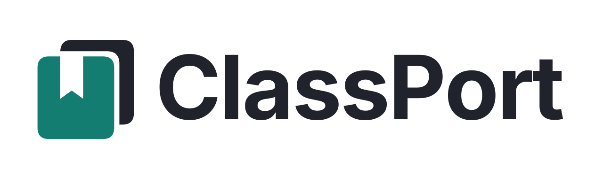
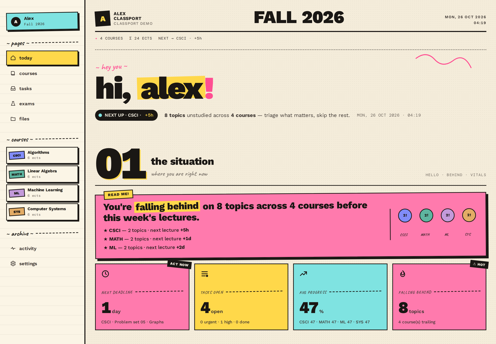
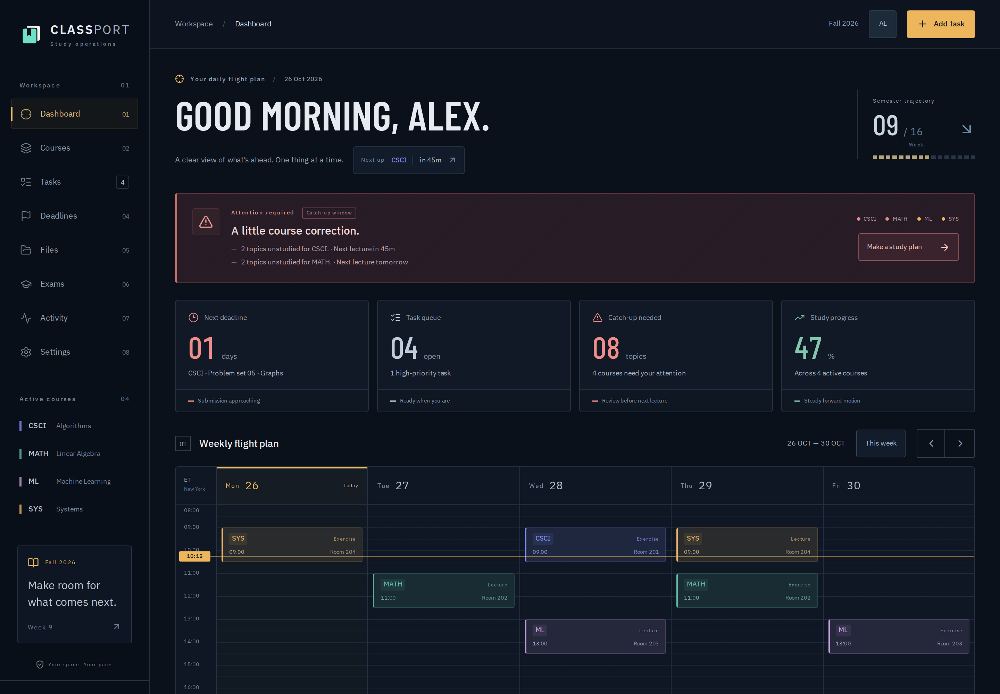
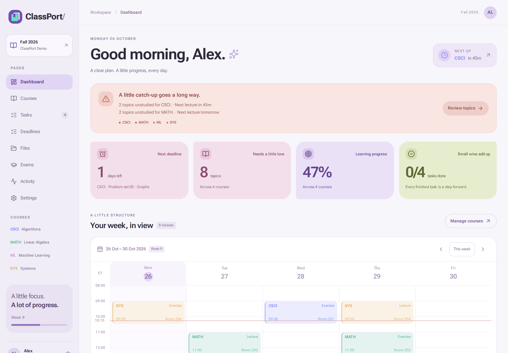
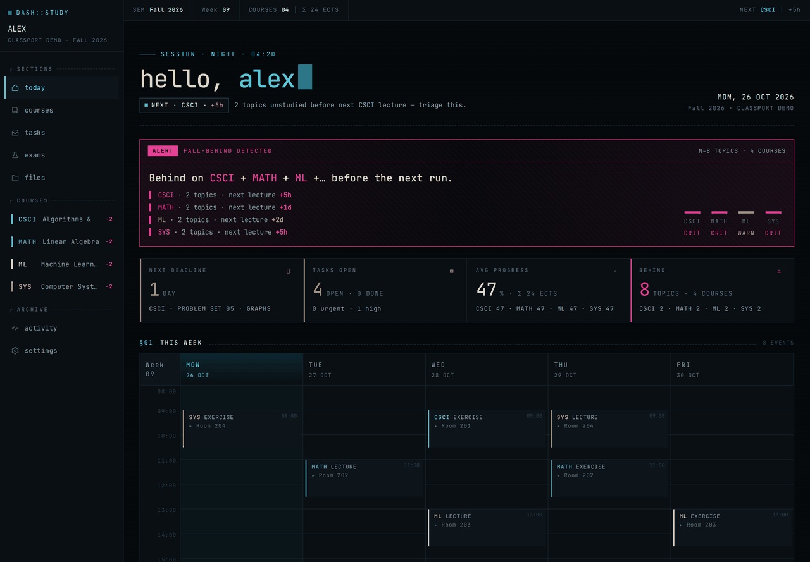
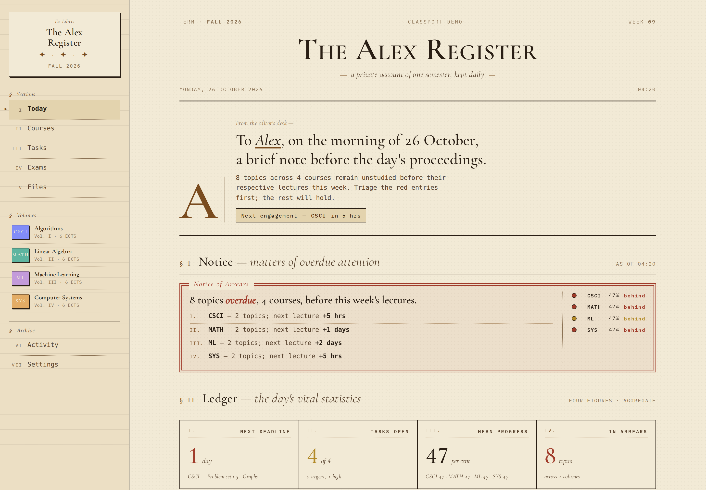
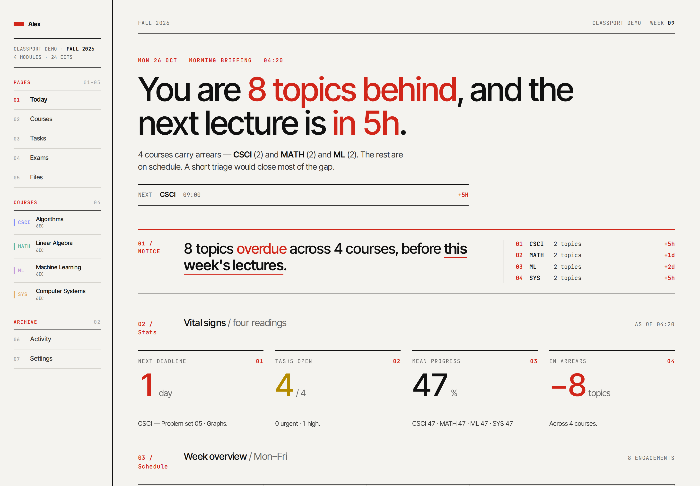
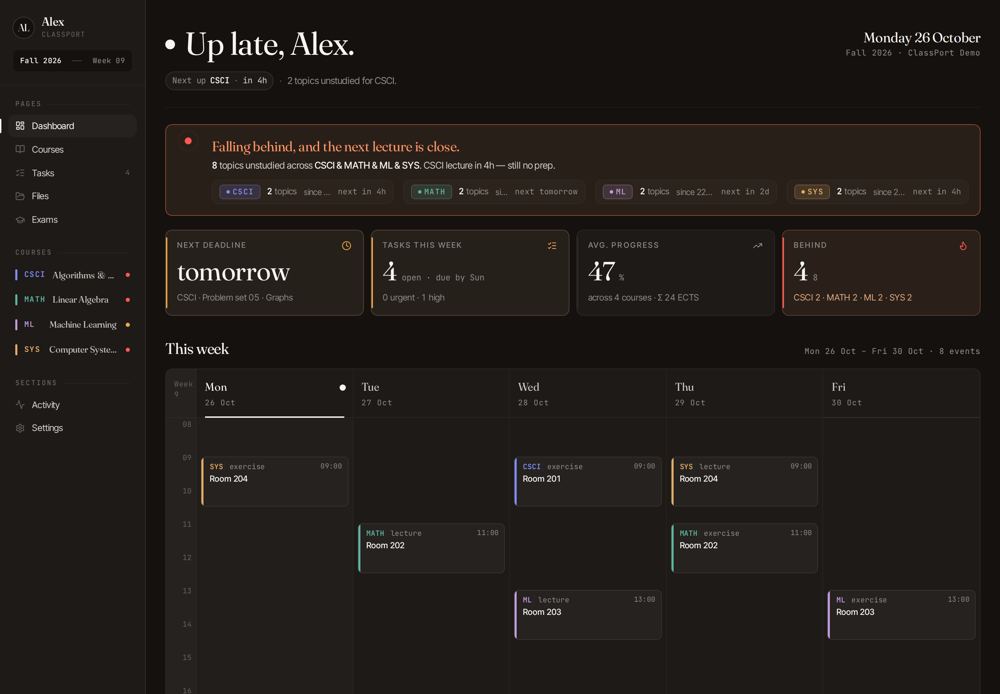
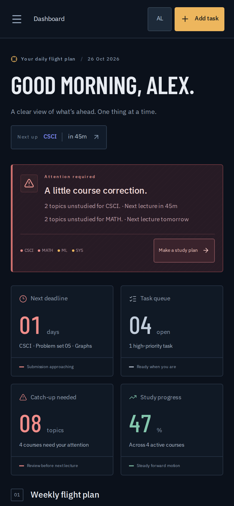

<p align="center">
  <picture>
    <source media="(prefers-color-scheme: dark)" srcset="docs/brand/wordmark/on-dark.svg" />
    
  </picture>
</p>

<p align="center">
  <a href="./README.md">English</a> | <a href="./README.zh-CN.md">简体中文</a>
</p>

# ClassPort

A self-hostable personal study dashboard. Track your **courses, schedule, lectures, study topics, deliverables, and tasks** in one place — and use **ChatGPT on the web** to read course material and update your study plan through MCP.



*Zine is the initial theme. Previews use sample course data.*

[Themes](#themes) · [Study workflow](#study-workflow) · [Cloud use](#use-in-the-cloud) · [Local setup](#quick-start) · [ChatGPT guide](./docs/chatgpt.md)

## Themes

Choose a theme in **Settings → Theme**. All seven themes work with the same courses, files, tasks, and study progress. Select a name below to open its preview.

| Theme | Style |
| --- | --- |
| [Zine](./docs/screenshots/theme-zine.png) — initial theme | Cream paper, colorful stickers, and a hand-drawn feel |
| [Mission Control](./docs/screenshots/theme-mission-control.png) | Deep navy, amber accents, and a mission dashboard |
| [Material Expressive](./docs/screenshots/theme-material.png) | Lavender surfaces, rounded shapes, and colorful cards |
| [Terminal](./docs/screenshots/theme-terminal.png) | Dark surfaces, monospaced text, and cyan accents |
| [Library](./docs/screenshots/theme-library.png) | Paper tones, sepia text, and a card-catalog layout |
| [Swiss](./docs/screenshots/theme-swiss.png) | A clear grid, large typography, and red accents |
| [Generic](./docs/screenshots/theme-classic.png) | Warm dark surfaces, serif headings, and generous spacing |

<details>
<summary>Mission Control preview</summary>



</details>

<details>
<summary>Material Expressive preview</summary>



</details>

<details>
<summary>Terminal — short animated preview</summary>



</details>

<details>
<summary>Library preview</summary>



</details>

<details>
<summary>Swiss preview</summary>



</details>

<details>
<summary>Generic preview</summary>



</details>

## Study workflow

After creating the `STAT201` course, setting its folder to `STAT201`, and [connecting ChatGPT](./docs/chatgpt.md), try this sequence:

| Step | What to do |
| --- | --- |
| Upload the material | In **Files**, upload the statistics homework PDF to `STAT201/homework-05.pdf`. |
| Read and review | In a connected ChatGPT web conversation: “Use ClassPort to read problem 4 in `STAT201/homework-05.pdf`. Explain why a sum of independent exponential random variables with the same rate has a Gamma distribution, how the central limit theorem gives a normal approximation, and ask me a review question.” |
| Save the next action | “Create a high-priority task for STAT201 called ‘Compare Gamma and normal PDF/CDF plots in R’.” Review the proposed change and confirm it if ChatGPT asks. |
| Check the result | Refresh the dashboard or open **Tasks** to check the saved task. You can also edit or complete it directly there. |

Uploads and replacements go through the dashboard's **Files** view. PDF reads return extracted text and page images; for scanned pages or diagrams that ChatGPT cannot see, attach the PDF or page image directly to the conversation. See the [file workflow guide](./docs/chatgpt.md#work-with-course-files).

Course schedules, date-only study topics, dashboard calendars, and time inputs use US Eastern Time (`America/New_York`), with automatic daylight saving (EST/EDT). Timestamps are stored and exchanged in UTC.

## Use in the cloud

Deploy ClassPort to your own server with HTTPS, then use the dashboard from a browser on your computer, tablet, or phone. Courses, tasks, progress, and uploaded material live in that installation. Sign in to the same account on another device and refresh the page to continue with the same saved records. Your everyday devices only need a browser; the application runs on the server.

For example, upload slides from your laptop before class, check your schedule from your phone, then use ChatGPT on the web to review the material and save your next study task.

1. **Open your dashboard.** Visit your deployment's address, such as `https://your-domain.tld`, and sign in with your ClassPort account.
2. **Set up your semester.** Add your profile, semester, and courses, then upload PDFs and notes through **Files**.
3. **Connect ChatGPT.** Use your installation's `https://your-domain.tld/mcp` endpoint, choose OAuth, and sign in to ClassPort to authorize the connection. Install and select the plugin in ChatGPT on the web; access depends on your account and workspace permissions. Follow the [ChatGPT setup guide](./docs/chatgpt.md).
4. **Continue across devices.** Saved changes from the dashboard and the connected ChatGPT conversation use the same data. Refresh the dashboard to check the result.

The domain above is an example; use the hostname configured for your own deployment. Cloud hosting is self-managed. Start with the [Docker and HTTPS installation guide](./INSTALL.md), or follow the [AWS setup](./infra/aws/README.md) and [production release workflow](./docs/PRODUCTION.md).

<details>
<summary>Phone browser preview — Mission Control</summary>



</details>

## How I use this

### The one-time setup

I use ChatGPT in the browser to turn course material into a semester plan, then keep that plan in ClassPort.

1. **Collect the source material.** Download the syllabus, timetable, exam rules, and lecture PDFs from the university's LMS. Keep a folder per course if that helps, but a local folder is not automatically visible to ChatGPT.
2. **Prepare a `course.md` with ChatGPT.** Attach the relevant documents to the conversation and ask for a normalized summary: course code, official name, ECTS, professor, language, exam format, weekly schedule, and grading or attendance rules. Check the summary against the originals and download the Markdown.
3. **Store the files in ClassPort.** Upload the PDFs and `course.md` through the dashboard's **Files** view, using a course prefix such as `STAT201/`. A chat attachment is not automatically copied into ClassPort, and adding files to a folder on your laptop does not upload them.
4. **Connect ChatGPT to ClassPort.** Follow the [ChatGPT setup guide](./docs/chatgpt.md), select the installed ClassPort plugin with `@`, and ask ChatGPT to read the uploaded `course.md`. Review the proposed entries, then have it call `create_course`, `create_schedule_slot`, `update_exam`, and `create_deliverable` as appropriate. Match the course's `folder_name` to the uploaded folder. ChatGPT may ask you to confirm changes.
5. **Check the dashboard.** Courses, weekly slots, exams, and deadlines now share the same data as the connected conversation.

**After that, update incrementally.** Upload new slides in **Files**. When a grading rule or exam date changes, ask ChatGPT to update the corresponding records. To change `course.md` itself, review the revised Markdown and upload the replacement through the dashboard.

### A typical week

**During a lecture.** In a connected ChatGPT web conversation: *"Use ClassPort to read problem 4 in `STAT201/homework-05.pdf`. Explain the shape and scale parameters of the Gamma distribution obtained by summing independent exponential random variables with the same rate."* ChatGPT uses `list_course_files` and `read_course_file`. PDF reads return page text alongside rendered images. If a diagram or scanned page is not available to the model, attach the original PDF or page image directly to the chat before asking about its visual details.

**After a lecture.** *"Today's STAT201 class covered Gamma distributions, normal approximations using the central limit theorem, and binomial proportion estimation. Record the lecture and those three topics, and mark attendance."* ChatGPT uses the lecture and topic tools; once the writes succeed, the dashboard shows the result.

**When studying.** *"Use ClassPort to find my unstudied STAT201 topics. Use problem 7 in the uploaded homework to explain why the binomial proportion estimator p̂ = X/n is unbiased and consistent, and how to obtain its asymptotic normal distribution. Ask a check question halfway through."* ChatGPT reads the topic and course material. When I confirm I understand it, *"mark ‘binomial proportion estimation’ studied"* calls `mark_studied`.

**Planning tomorrow.** *"What is due this week? Add a high-priority STAT201 task to plot the Gamma distribution's PDF and CDF alongside their normal approximations in R for n = 10, 20, 30, 40, and 50 by Monday 16:00."* ChatGPT reads the user's timezone and settings before interpreting dates, then saves the task through ClassPort.

The dashboard and the connected ChatGPT conversation use the same database. I can also create and edit entries directly in the dashboard.


## What makes it different

The MCP server lets **ChatGPT read and update your study records**: courses, weekly slots, lectures, topics, deadlines, and tasks. It also lists uploaded course files and reads selected PDF pages. Upload and replace files in the dashboard's **Files** view.

- **Multi-tenant:** every owned table carries a `user_id` FK. Data isolation is enforced at the service layer (WHERE filters) and the schema layer (composite FKs + RLS policies). Run it solo or flip `SIGNUPS_ENABLED=true` to open registration — same codebase, same deploy.

Connect ClassPort as an OAuth-protected MCP plugin in **ChatGPT on the web**, then select it in a conversation to work with the same coursework shown in the dashboard. See the [ChatGPT guide](./docs/chatgpt.md) for setup and supported file workflows.

## You'll need

To run your own installation, have:

- **Docker** + **Docker Compose v2.30+** (the stack — Postgres, FastAPI, frontend — all run as containers)
- **Node 20+** and **pnpm** (via [corepack](https://pnpm.io/installation#using-corepack)) for building the frontend
- A **public HTTPS hostname** for ChatGPT to reach the MCP endpoint, and a ChatGPT account/workspace permitted to add custom MCP plugins
- Time to configure database credentials, your account, and HTTPS

The local stack runs on one Docker-capable machine. A VPS can host it behind HTTPS; the AWS deployment uses separate application, database, and file-storage services. Once your installation is running, daily use only requires a browser.

## Quick start

Get the full stack running locally. The frontend is built once and served by Caddy in production; for development, run it with `pnpm dev` against the dockerised backend.

**1. Clone + install frontend deps.**

```bash
git clone https://github.com/DonSteven/ClassPort
cd ClassPort
cd web && pnpm install && cd ..
```

**2. Configure separate runtime and maintenance credentials.**

```bash
cp .env.example .env
cp .env.migration.example .env.migration
cp .env.docker.example .env.docker
cp .env.jobs.example .env.jobs
chmod 600 .env .env.migration .env.docker .env.jobs
```

Set `DATABASE_URL`, `SESSION_SECRET`, and `SECRETS_ENCRYPTION_KEY` in
`.env`. Set `MIGRATION_DATABASE_URL`, your `OPERATOR_EMAIL`, and
`APP_PASSWORD_HASH` in `.env.migration`. Generate the password hash with
`uv run python -m app.tools.hashpw`; generate separate random database passwords.

The URLs target the same database using different roles. The backend loads
`.env` and shared task settings from `.env.jobs`; maintenance loads only `.env.migration`. The local PostgreSQL
container loads `.env.docker`, which also supplies public frontend build settings.

Follow [database setup](docs/DATABASE.md) to provision the roles and grants before
the first deploy, or to adapt an existing installation. That guide also covers
pool settings and verified TLS connections to RDS.

**3. Bring up the stack.**

```bash
./deploy.sh
```

`deploy.sh` validates compose, builds the classport image, runs migrations and operator initialization with maintenance credentials, starts the runtime backend and frontend, then polls readiness at `GET /api/health` for up to 60 s. If readiness doesn't pass it auto-rolls back to the previously deployed image.

For RDS / external PostgreSQL, use `./deploy.sh --external-db` on every deploy to skip local Postgres.

For EC2 with RDS, S3, and immutable application images, use the separate
[production release workflow](docs/PRODUCTION.md). It keeps local deployment
independent and restores the frontend/backend image pair together on failure.

The backend is now live at `http://127.0.0.1:8000`. Verify:

```bash
curl -f --max-time 3 http://127.0.0.1:8000/api/health/live
# → {"ok":true,"version":"..."}
curl -f --max-time 3 http://127.0.0.1:8000/api/health/ready
# → {"ok":true,"version":"...","db":"ok","storage":"ok"}
```

Liveness checks only that the application responds. Readiness checks a database
round trip and whether `STUDY_ROOT` can be listed, with a shared 2 s timeout;
failure or timeout returns HTTP 503. `/api/health` is the same readiness check,
kept for deployment and rollback to older images. Docker health also reports
readiness; becoming `unhealthy` does not itself restart the container or stop
proxy traffic. See [health checks](INSTALL.md#health-checks) for details.

**4. Use it.**

The frontend is also a container — `./deploy.sh` brought it up at
`http://127.0.0.1:8080`. Open that in your browser and log in with the
password you hashed. For a public domain, just point your reverse proxy
(Caddy / nginx / etc.) at `127.0.0.1:8080` — the in-container Caddy
handles routing static assets vs. proxying API/MCP traffic.

For local frontend development with Vite hot-reload:

```bash
echo "VITE_API_BASE_URL=http://localhost:8000" > web/.env.local
cd web && pnpm dev   # → http://localhost:5173
```

Stuck or want the production checklist? Full walkthrough is in **[INSTALL.md](./INSTALL.md)**.

## What you do inside the app

On first boot, everything's empty. You build it up in the UI (through ChatGPT with the ClassPort plugin selected):

1. **Settings → Profile**: name, monogram, institution
2. **Settings → Semester**: label (e.g. "Fall 2026"), start/end dates, timezone (default: `America/New_York`), locale
3. **Courses → +**: create each course with a short code (STAT201, CS101…), a full name, and an accent color
4. **Course detail**: add schedule slots (weekday / time / room), upcoming deliverables, and the study topics you're expected to cover
5. **Dashboard**: lives here. Greeting, *falling-behind* banner, metric tiles, weekly grid, course cards, deadlines + tasks.

## Connect ChatGPT

ClassPort exposes an OAuth-protected Streamable HTTP MCP endpoint at `https://your-domain.tld/mcp` for **ChatGPT on the web**. Deploy it behind HTTPS and set `PUBLIC_URL` to the same public origin. A local dashboard alone does not make `localhost` reachable from ChatGPT.

In [ChatGPT Plugins](https://chatgpt.com/plugins), choose **+ → Add custom MCP server**, enter the endpoint, and select **OAuth**. ClassPort supports dynamic client registration (DCR); leave static client credentials empty. Complete the ClassPort login and consent, install the resulting plugin, then select it with `@` in a new conversation. Availability is subject to your account and workspace permissions. See OpenAI's [custom MCP guide](https://developers.openai.com/api/docs/guides/custom-mcp-server).

Try: *"Use ClassPort to list my courses and tell me what is due this week."* For a write, review the proposed change and approve it if ChatGPT asks. Reopen the dashboard to verify it was saved.

For file workflows, OAuth troubleshooting, and references to official documentation and community reports, see [Using ClassPort with ChatGPT](./docs/chatgpt.md). Paste the [study prompt](./docs/chatgpt-study-prompt.md) into a conversation where the plugin is enabled; the prompt itself does not install or authorize it.


## What's in here

```
app/                FastAPI + MCP server (Python, uv-managed)
  routers/          HTTP endpoints
  services/         Database queries + business logic
  mcp_tools.py      The MCP tools
  schemas.py        Pydantic models
migrations/         SQL files run by scripts/run_migrations.py at deploy time
  00000000000000_baseline.sql  Initial multi-user schema; later migrations extend it
web/
  src/              Vite + React 19 + Tailwind + shadcn/ui frontend
scripts/
  run_migrations.py Idempotent migration runner with checksum tracking
docker-compose.yml  Postgres + FastAPI on an internal network
Dockerfile          Builds the classport:latest image
deploy.sh           Build → migrate → roll → health-gate → rollback-on-fail
docs/
  chatgpt.md                   ChatGPT web setup, file workflows, and references
  chatgpt.zh-CN.md             Simplified Chinese guide
  chatgpt-study-prompt.md       Reusable study instructions
  chatgpt-study-prompt.zh-CN.md Simplified Chinese study instructions
```

## Stack

The local Docker setup serves the application through a reverse proxy. The [AWS deployment](./infra/aws/README.md) runs application services on EC2, PostgreSQL on RDS, and course material in a private S3 bucket.

- **Frontend:** Vite + React 19 + TypeScript + Tailwind + shadcn/ui, built into a Caddy:alpine image that serves the SPA and proxies API traffic to the backend on the internal docker network
- **Backend:** FastAPI (Python 3.12) running as one uvicorn worker, talking to Postgres directly via `psycopg` async pool
- **Data:** Postgres 16 (internal-network only — never exposed to the host)
- **Files:** local storage under `STUDY_ROOT` (default `/opt/courses`) for the local setup; a private, versioned S3 bucket for the AWS setup
- **MCP:** Python `mcp` SDK, mounted at `/mcp` over Streamable HTTP with OAuth 2.1
- **Hosting:** anywhere Docker runs — bring your own outer reverse proxy (Caddy in [INSTALL.md](./INSTALL.md)) for TLS termination

## License

MIT — do whatever you like. Credit / a star / a link back is appreciated but not required.

## Contributing

**Yes, please.** If you self-host this and something breaks, something feels off, or you wish it did one more thing — open an issue or a PR. No ceremony. Typo fixes, a clearer sentence in INSTALL.md, a new MCP tool you wrote for your own use, a CSS tweak that makes the mobile layout less cramped — all welcome.

If you're unsure whether a bigger change is in scope, a quick *"would you take a PR that does X?"* issue is the easy way to find out.
